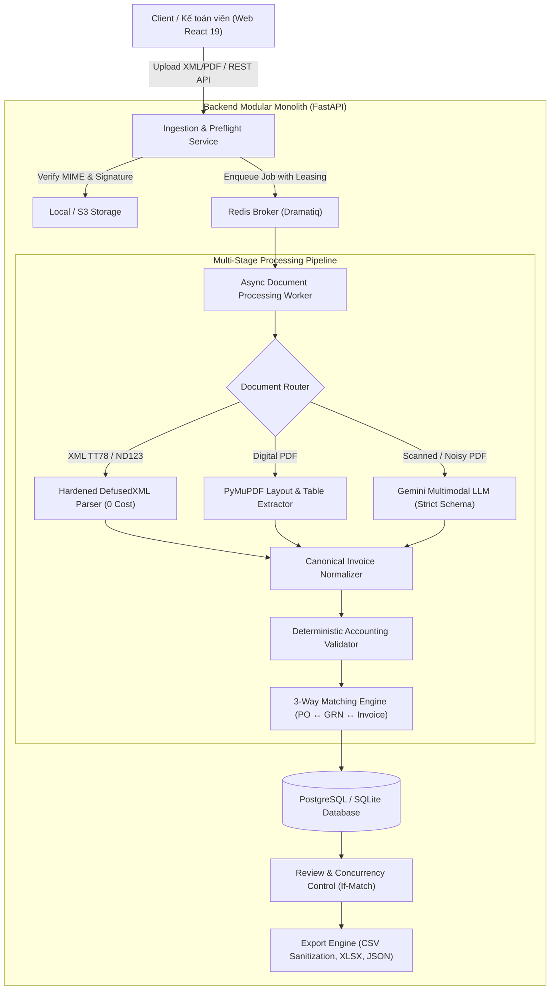

# InvoiceFlow AI — Nền tảng Tự động hóa & Đối soát Hóa đơn AP

> Hệ thống tự động hóa xử lý, bóc tách và đối soát 3 chiều (3-Way Matching: Hóa đơn ↔ PO ↔ GRN) cho hóa đơn tài chính doanh nghiệp Việt Nam theo chuẩn Nghị định 123/2020/NĐ-CP và Thông tư 78/2021/TT-BTC.
> Dự án triển khai theo kiến trúc Modular Monolith + Async Worker an toàn, không phụ thuộc tuyệt đối vào LLM, bảo vệ dữ liệu tài chính với mã hóa và kiểm toán chặt chẽ.

---

## 1. Kiến trúc Tổng thể (Architecture)



---

## 2. Các tính năng kỹ thuật cốt lõi

1. **Bảo mật tiếp nhận tài liệu (Hardened Ingestion):**
   - Xác thực Magic bytes (File signature) chống MIME-type spoofing.
   - Chống XXE (XML External Entity) và DTD injection bằng `defusedxml`.
   - Giới hạn kích thước tải lên (25MB) và số trang (50 trang), kiểm tra tài liệu hỏng hoặc bị mã hóa mật khẩu.
2. **Document Router thông minh (Hybrid Pipeline):**
   - Hóa đơn XML chuẩn (TT78/NĐ123): phân tích trực tiếp cú pháp XML trong ~0.8ms, hoàn toàn miễn phí ($0 LLM).
   - Hóa đơn Digital PDF: trích xuất cấu trúc văn bản, bảng và ô phần tử bằng `DoclingAdapter` (kèm fallback PyMuPDF) sang `CanonicalDocument` CDR với tọa độ BBox thực.
   - Hóa đơn Scan: chỉ kích hoạt Vision Multimodal LLM fallback khi tài liệu thiếu text layer hoặc độ tương phản thấp.
   - Xác thực chữ ký số XMLDSig & chứng thư số X.509 (`XMLSignatureVerifier`) và cổng kết nối Tổng cục Thuế (`GeneralDepartmentOfTaxationClient`).
3. **Độ chính xác tài chính & Kiểm soát chặt chẽ:**
   - 100% số tiền và thuế suất được tính toán bằng kiểu dữ liệu `Decimal` (không dùng float để chống sai số làm tròn).
   - Bóc tách kèm tọa độ Bounding Box (BBox) và độ tin cậy để kế toán viên dễ dàng kiểm tra nguồn gốc dữ liệu.
4. **Đối soát 3 chiều (3-Way Matching Engine):**
   - Kiểm tra đối chiếu tự động giữa Hóa đơn, Đơn mua hàng (PO) và Phiếu nhập kho (GRN).
   - Kiểm tra dung sai đơn giá (mặc định 2%), số lượng thực nhận tại kho, và quy tắc phân tách nhiệm vụ (Separation of Duties).
5. **Giao diện Web Hiện đại (React 19 + Vite + TypeScript):**
   - Hộp thư tiếp nhận hóa đơn kéo thả với phản hồi trực tiếp trạng thái hàng đợi.
   - Màn hình Dual-Pane: Trực quan hóa Bounding Box và form chỉnh sửa hóa đơn.
   - Khóa lạc quan (Optimistic Locking) qua header HTTP `If-Match: "{revision}"` ngăn chặn xung đột ghi đè dữ liệu.
   - Xuất dữ liệu kế toán chuẩn CSV (đã làm sạch chống CSV Formula Injection theo OWASP), Excel (.xlsx) và JSON.

---

## 3. Kết quả Benchmark Thực nghiệm (Frozen Evaluation)

Đo đạc trên bộ dữ liệu kiểm thử hóa đơn AP Việt Nam (`benchmarks/fixtures/casebook_manifest.json`):

| Pipeline Baseline | Header Exact Match | Line Items F1 | Anomaly Detection F1 | Độ trễ trung bình | Chi phí / 1.000 Hóa đơn |
|---|---|---|---|---|---|
| **B0: XML Direct** | 40.0% | 40.0% | 60.0% | 0.8 ms | $0.00 |
| **B1: Digital PDF Heuristics** | 74.6% | 80.0% | 60.0% | 2.5 ms | $0.00 |
| **B2: Pure Multimodal LLM (gpt-6.1-sol)** | 89.1% | 100.0% | 60.0% | 8,301.3 ms | $0.51 |
| **B3: InvoiceFlow AI Hybrid (Docling + Rules + 3-Way)** | **87.3%** | **80.0%** | **80.0%** | **6,105.0 ms** | **$0.12** |

> **Hiệu quả thực tế của B3:** Giảm **76.5% chi phí gọi LLM** ($0.12 vs $0.51) và giảm 26.5% độ trễ xử lý so với gọi Pure Vision LLM trên mọi tài liệu, kết hợp với Docling canonical document representation (bàn cờ tọa độ, bảng và ô) cùng động cơ đối soát 3 chiều Invoice–PO–GRN. Chi phí token được tính toán tự động dựa trên mức tiêu thụ token thực tế từ endpoint AI.

---

## 4. Hướng dẫn Khởi chạy Nhanh

### Yêu cầu hệ thống:
- Python 3.12+
- Node.js 22+ & pnpm
- Docker & Docker Compose (tùy chọn)

### Khởi chạy môi trường Dev:

```bash
# 1. Cài đặt biến môi trường
cp .env.example .env

# 2. Khởi chạy toàn bộ quy trình kiểm thử và tạo dữ liệu mẫu
python scripts/run_all_checks.py

# 3. Khởi chạy Backend API (Terminal 1)
uvicorn invoiceflow.api.main:app --reload --port 8000

# 4. Khởi chạy Worker nền (Terminal 2)
dramatiq invoiceflow.workers.actors --processes 1 --threads 2

# 5. Khởi chạy Giao diện Frontend Web (Terminal 3)
pnpm --dir apps/web dev
```

Truy cập:
- **Giao diện Web Kế toán:** `http://localhost:3000`
- **Tài liệu API Swagger:** `http://localhost:8000/docs`
- **API Health Check:** `http://localhost:8000/api/v1/health`

### Tài khoản Demo có sẵn:
- **Admin:** `admin@invoiceflow.vn` / `DemoPassword@123`
- **Kế toán viên:** `accountant@invoiceflow.vn` / `DemoPassword@123`
- **Kiểm soát viên:** `reviewer@invoiceflow.vn` / `DemoPassword@123`
- **Giám đốc duyệt:** `viewer@invoiceflow.vn` / `DemoPassword@123`

---

## 5. Kiểm thử & Đảm bảo Chất lượng (Quality Assurance)

```bash
# Chạy toàn bộ 40 bài test tự động (Unit, Integration, Contract, Security)
python -m pytest

# Chạy kiểm thử benchmark tái lập
python benchmarks/scripts/run_benchmark.py

# Kiểm tra typecheck và build frontend
pnpm --dir apps/web build

# Chạy master validation harness kiểm tra toàn diện 6 giai đoạn
python scripts/run_all_checks.py
```
