# InvoiceFlow AI — Nền tảng Tự động hóa & Đối soát Hóa đơn Tài chính AP

> **InvoiceFlow AI** là hệ thống xử lý chứng từ (Intelligent Document Processing - IDP) cho hóa đơn tài chính tại Việt Nam theo **Nghị định 123/2020/NĐ-CP** và **Thông tư 78/2021/TT-BTC**. Hệ thống hỗ trợ tiếp nhận đa định dạng (XML, PDF điện tử, PDF scan, ảnh chụp), thực hiện đối soát 3 chiều (**3-Way Matching: Hóa đơn ↔ PO ↔ GRN**), hỗ trợ xử lý tự động (**Straight-Through Processing - STP**) và quản lý dữ liệu tài chính theo mô hình Clean Architecture.

---

## 1. Kiến trúc Tổng thể (System Architecture)

InvoiceFlow AI được tổ chức theo mô hình **Modular Monolith + Async Worker** với các tầng phân tách một chiều (`API -> Application -> Domain <- Infrastructure`), phân định trách nhiệm giữa Ingestion, Preflight, Preprocessing, Routing, Extraction, Verification, Matching và Review.

```mermaid
flowchart TD
    Client["Client / Kế toán viên (React 19 + TypeScript)"] -->|Upload XML / PDF / Image| Ingestion["Ingestion & Preflight Service"]
    
    subgraph CoreBackend["Backend Modular Monolith (FastAPI)"]
        Ingestion -->|Kiểm tra Magic Bytes, chặn XXE/DTD, lọc PDF mã hóa| Storage["Local / S3 Storage"]
        Ingestion -->|Gửi Job kèm Tenant Context| Queue["Redis Broker (Dramatiq)"]
        
        Queue --> Worker["Async Document Processing Worker"]
        
        subgraph Pipeline["Quy trình Xử lý Tài liệu"]
            Worker --> Preprocessor{"Image Preprocessor"}
            Preprocessor -->|Ảnh chụp| CV["Tiền xử lý Computer Vision<br/>(Ước lượng độ mờ/độ sáng, nắn 4 điểm, cân góc, CLAHE)"]
            Preprocessor -->|PDF / XML gốc| Router{"Document Router"}
            CV --> Router
            
            Router -->|XML TT78 / ND123| XMLParser["Phân tích DefusedXML (xử lý trực tiếp)"]
            Router -->|Digital PDF| DoclingParser["Docling Adapter & PyMuPDF (Trích xuất BBox & Layout)"]
            Router -->|Scanned PDF| EasyOCR["EasyOCR Pipeline + Chuẩn hóa xoay trang"]
            
            DoclingParser --> RegionRecovery{"Kiểm tra thiếu số lượng / gộp ô"}
            EasyOCR --> RegionRecovery
            RegionRecovery -->|Có nghi ngờ| CropRetry["Targeted Crop OCR<br/>(250 DPI + CLAHE + Kiểm tra số học)"]
            RegionRecovery -->|Bình thường| Canonical["Canonical Document (CDR)"]
            CropRetry --> Canonical
            
            Canonical --> VisionGate{"Trường dữ liệu còn thiếu?"}
            VisionGate -->|Đã đủ căn cứ| Verifier["Multi-Signal Verifier (9 trạng thái xác minh)"]
            VisionGate -->|Thiếu thông tin chính| VisionFallback["Vision Multimodal LLM (Fallback có kiểm soát)"]
            VisionFallback --> Verifier
            XMLParser --> Verifier
            
            Verifier --> Validator["Accounting Validator<br/>(Kiểm tra MST Mod-11, thuế suất luật định, kiểm tra trùng lặp)"]
            Validator --> Engine["3-Way Matching Engine<br/>(Hóa đơn ↔ PO ↔ GRN kèm từ đồng nghĩa ĐVT & dung sai)"]
            Engine --> STPEval["STP Evaluator (Đánh giá điều kiện tự động duyệt)"]
        end
        
        STPEval -->|Đủ điều kiện & khớp dữ liệu| AutoApprove[("Tự động duyệt STP (Lưu Audit Log)")]
        STPEval -->|Có sai lệch / cần xác nhận| HumanReview[("Chuyển Human Review (Ready for Review)")]
        
        AutoApprove --> Database[("PostgreSQL / SQLite Storage")]
        HumanReview --> Database
        Database --> ReviewService["Review Service (Optimistic Locking If-Match)"]
        ReviewService --> Exporter["Export Engine (Xuất CSV làm sạch, XLSX, JSON)"]
    end
```



---

## 2. Các Tính năng Kỹ thuật (Technical Capabilities)

### 2.1. Tiếp nhận & Kiểm tra Tệp tin (Ingestion & Preflight)
- **Kiểm tra Chữ ký Tệp (Magic Bytes):** Xác thực định dạng tệp tin thực tế dựa trên header nhị phân để phòng ngừa việc đổi đuôi mở rộng.
- **Phòng ngừa XML XXE & DTD:** Sử dụng `defusedxml` để tắt việc phân giải thực thể ngoài (external entities), DTD và XInclude theo khuyến nghị OWASP.
- **Xử lý Tệp không Hợp lệ:** Kiểm tra và từ chối các tệp PDF bị lỗi cấu trúc hoặc có cài đặt mật khẩu (`doc.is_encrypted`) trước khi đưa vào hàng đợi xử lý.
- **Lọc Dữ liệu Nhạy cảm (PII Redaction):** Tự động che các chuỗi có định dạng Bearer token, API key, mật khẩu và số thẻ trong log vận hành.

### 2.2. Tiền xử lý Hình ảnh (Computer Vision)
- **Đánh giá Chất lượng Ảnh:** Tính toán độ sắc nét (Laplacian variance), độ sáng trung bình và độ tương phản histogram để nhận biết ảnh quá mờ hoặc thiếu sáng.
- **Hiệu chỉnh Phối cảnh & Góc nghiêng:** Tìm đường biên tài liệu (`approxPolyDP`), nắn phối cảnh 4 điểm (`warpPerspective`) và xoay thẳng góc nghiêng nhỏ ($\pm 15^\circ$) bằng MinAreaRect.
- **Cải thiện Độ tương phản:** Áp dụng thuật toán CLAHE trên kênh độ sáng (L) của không gian màu Lab để giảm ảnh hưởng của bóng mờ.
- **Ánh xạ Tọa độ:** Lưu ma trận biến đổi afin để quy đổi tọa độ Bounding Box từ ảnh đã xử lý về lại ảnh gốc phục vụ việc hiển thị đối chiếu.

### 2.3. Bóc tách Bố cục & Thử lại Vùng Cục bộ
- **Trích xuất Bảng:** Nhận diện và bỏ qua các hàng tổng (như *"Cộng tiền hàng"*, *"Tổng cộng tiền thanh toán"*, *"Tiền thuế GTGT"*); hỗ trợ nối các dòng mô tả hàng hóa trải dài nhiều hàng kèm gộp vùng tọa độ.
- **Chuẩn hóa Thông tin:** Hỗ trợ đọc các định dạng ngày tháng tiếng Việt thông dụng, phân biệt vị trí MST người bán và người mua, phân tách số hóa đơn khỏi ký hiệu mẫu số.
- **Thử lại Vùng Cục bộ (Targeted Region OCR):** Khi phát hiện ô bị nghi ngờ gộp nhầm (`CELL_MERGE_SUSPECTED`) hoặc thiếu số lượng, hệ thống crop riêng vùng ô ở độ phân giải 250 DPI và chạy nhận diện lại. Nếu phép tính ($\text{Số lượng} \times \text{Đơn giá} - \text{Chiết khấu} = \text{Thành tiền}$) khớp, dữ liệu được cập nhật mà không cần chuyển tiếp sang bước Vision LLM bên ngoài.

### 2.4. Xác minh Tín hiệu & Kiểm tra Nghiệp vụ Tài chính
- **Trạng thái Xác minh Trường (`FieldVerificationState`):** Phân loại dữ liệu theo 9 trạng thái: `VALID`, `ZERO`, `MISSING`, `INVALID`, `UNCERTAIN`, `CONFLICT`, `ARITHMETICALLY_CONSISTENT`, `MODEL_PROPOSED`, `HUMAN_APPROVED`.
- **Kiểm tra Thuật toán Mã số Thuế (MST):** Xác thực cấu trúc 10 số hoặc 13 số (`^\d{10}(?:-\d{3})?$`) và đối chiếu số kiểm tra theo thuật toán Modulo-11 quy định cho doanh nghiệp Việt Nam.
- **Kiểm tra Thuế suất:** So sánh với danh mục thuế suất GTGT quy định (0%, 5%, 8%, 10%, không chịu thuế KCT) và kiểm tra tương quan giữa thành tiền và tiền thuế.
- **Kiểm tra Trùng lặp Hóa đơn:** Rà soát trong phạm vi từng tenant theo bộ 3 khóa: MST Người bán + Ký hiệu Mẫu số + Số hóa đơn.
- **Lưu trữ Số học với Kiểu Decimal:** Sử dụng kiểu dữ liệu `Decimal` cho toàn bộ các trường tiền tệ và đơn giá để tránh sai số làm tròn của số thực (`float`).

### 2.5. Hỗ trợ Xử lý Tự động (STP) & Quy trình Review
- **Đánh giá Điều kiện Tự động Duyệt (`STPEvaluator`):** Cho phép hóa đơn hoàn tất tự động khi tổng tiền nằm trong hạn mức cấu hình, khớp dữ liệu với PO/GRN (hoặc XML hợp lệ), không có trường xung đột và phép tính dòng hàng cân bằng.
- **Chuyển Bước Rà soát Thủ công:** Tự động định tuyến sang trạng thái `READY_FOR_REVIEW` khi có cảnh báo chênh lệch dữ liệu hoặc tồn tại đề xuất từ mô hình Vision (`*.candidate_vision`) chưa được kế toán viên xác nhận.
- **Kiểm soát Cạnh tranh (Optimistic Concurrency Control):** Sử dụng trường phiên bản (`revision`) và HTTP Header `If-Match` để kiểm tra cập nhật đồng thời, tránh việc ghi đè dữ liệu giữa các phiên làm việc.

---

## 3. Cấu trúc Thư mục Dự án

```text
invoiceflow/
├── apps/
│   └── web/                                    # Frontend React 19 + Vite + TypeScript + Tailwind CSS
│       └── src/
│           ├── features/processing/            # BBox Overlay, ExtractionPanel, AuditSection
│           └── lib/api/                        # Typed API Client
├── src/
│   └── invoiceflow/
│       ├── api/                                # REST Routers & Request/Response Contracts
│       │   └── routers/                        # documents, invoices, health, auth
│       ├── application/                        # Use Cases, Ports & Điều phối
│       │   ├── ingestion/                      # Preflight Security & Validation
│       │   ├── processing/                     # Coordinator, Router, Service, MultiSignalVerifier
│       │   ├── reconciliation/                 # MatchingEngine, Validator, STPEvaluator
│       │   └── review/                         # ReviewService (Optimistic Locking & Giải quyết xung đột)
│       ├── domain/                             # Invariants, Enums & Financial Aggregate Models
│       │   ├── documents/                      # Canonical Document Representation (CDR), BBox
│       │   └── invoices/                       # InvoiceAggregate, InvoiceLine, VerificationStates
│       ├── infrastructure/                     # Adapters, SDKs & Persistence
│       │   ├── database/                       # SQLAlchemy 2.0 ORM & Repositories
│       │   ├── document/                       # ImagePreprocessor, DoclingAdapter, TableExtractor, RegionRecoverer
│       │   ├── logging/                        # PIIRedactingFilter & Telemetry
│       │   └── llm/                            # Vision Multimodal LLM Adapters
│       └── workers/                            # Dramatiq Async Job Actors
├── tests/
│   ├── unit/                                   # 144 Unit Tests
│   ├── contracts/                              # 2 Contract Tests
│   └── integration/                            # 21 Integration Tests
└── scripts/                                    # Seed demo, kiểm tra môi trường & QA scripts
```

---

## 4. Kết quả Kiểm định (Verification & Test Results)

Kết quả đo đạc từ bộ kiểm thử tự động của hệ thống:

| Tiêu chuẩn Kiểm định | Kết quả Ghi nhận | Ngưỡng Yêu cầu | Đánh giá |
|---|---|---|---|
| **Bóc tách Dòng hàng (Line Items F1)** | **100.0%** | $\ge 70.0\%$ | Đạt yêu cầu trên tập mẫu thử nghiệm |
| **Tính hợp lệ Số học (Arithmetic Validity)** | **100.0%** | $100.0\%$ | Khớp công thức $\text{Số lượng} \times \text{Đơn giá} - \text{Chiết khấu} = \text{Thành tiền}$ |
| **Phát hiện Bất thường Đối soát (Anomaly F1)**| **100.0%** | $100.0\%$ | Phát hiện các trường hợp lệch đơn giá PO và thiếu hàng GRN |
| **Khớp Thông tin Tiêu đề (Header Match)** | **94.5%** | $\ge 70.0\%$ | Nhận diện MST, ký hiệu, số hóa đơn, ngày lập |
| **Nhận diện Số tiền OCR (EasyOCR)** | **100.0%** | $100.0\%$ | Nhận diện trường số tiền trên tập mẫu scan và xoay góc |
| **Bộ Kiểm thử Tự động Backend** | **167/167 tests đạt** | $100.0\%$ | 144 unit tests, 2 contract tests, 21 integration tests |
| **Kiểm tra Mã nguồn Python (Ruff)** | **0 lỗi** | 0 lỗi | Đạt chuẩn linting và formatting trên 110 files |
| **Biên dịch Ứng dụng Web (Vite & TypeScript)** | **Thành công** | 0 lỗi typecheck | `tsc --noEmit` và `vite build` hoàn tất bình thường |

---

## 5. Hướng dẫn Khởi chạy (Setup & Run)

### Yêu cầu Môi trường:
- **Python:** 3.12+
- **Node.js:** 20+ & `pnpm` hoặc `npm`
- **Bộ nhớ RAM:** Tối thiểu 8 GB

### Các bước Thiết lập:

```bash
# 1. Clone repository và cấu hình file môi trường
git clone https://github.com/nvtanphat/invoiceflow-ai.git
cd invoiceflow-ai
cp .env.example .env

# 2. Cài đặt thư viện Python
pip install -e .

# 3. Tạo cơ sở dữ liệu và nạp dữ liệu mẫu đối soát (PO, GRN, hóa đơn mẫu)
python scripts/seed_demo.py

# 4. Chạy Backend API Server (Terminal 1)
uvicorn invoiceflow.api.main:app --host 0.0.0.0 --port 8000 --reload

# 5. Chạy Worker xử lý nền (Terminal 2)
dramatiq invoiceflow.workers.actors --processes 1 --threads 2

# 6. Cài đặt và khởi chạy Frontend Web (Terminal 3)
npm --prefix apps/web install
npm --prefix apps/web run dev
```

### Các Điểm cuối:
- **Giao diện Web:** `http://localhost:3000`
- **Tài liệu API (Swagger UI):** `http://localhost:8000/docs`
- **Health Check:** `http://localhost:8000/api/v1/health`

### Tài khoản Mẫu Kiểm thử:
| Vai trò | Email Đăng nhập | Mật khẩu Mặc định | Chức năng chính |
|---|---|---|---|
| **Quản trị viên (Admin)** | `admin@invoiceflow.vn` | `DemoPassword@123` | Quản trị tenant và phân quyền |
| **Kế toán viên (Accountant)** | `accountant@invoiceflow.vn` | `DemoPassword@123` | Tải lên tài liệu, chỉnh sửa dữ liệu bóc tách |
| **Kiểm soát viên (Reviewer)** | `reviewer@invoiceflow.vn` | `DemoPassword@123` | Rà soát chênh lệch, xác nhận xử lý cảnh báo |
| **Người phê duyệt (Approver)** | `viewer@invoiceflow.vn` | `DemoPassword@123` | Xác nhận phê duyệt thanh toán |

---

## 6. Lệnh Kiểm thử (Testing Commands)

```bash
# Chạy bộ unit tests
python -m pytest tests/unit/ -v

# Chạy kiểm thử API contracts
python -m pytest tests/contracts/ -v

# Chạy kiểm thử tích hợp xử lý ảnh
python -m pytest tests/integration/test_image_invoice_processing.py -v

# Chạy kiểm thử đối soát layout hóa đơn
python -m pytest tests/integration/test_diverse_invoice_layouts.py -v

# Chạy kiểm thử OCR
python -m pytest tests/integration/test_ocr_quality.py -v

# Kiểm tra code style và định dạng
python -m ruff check src tests
python -m ruff format --check src tests

# Kiểm tra typecheck và build frontend
npm --prefix apps/web run lint
npm --prefix apps/web run build
```

---

## 7. Tuân thủ Quy định & Bảo mật

- **Chuẩn hóa Hóa đơn Điện tử:** Tuân theo cấu trúc dữ liệu theo Nghị định 123/2020/NĐ-CP và Thông tư 78/2021/TT-BTC; kiểm tra tính hợp lệ của số hóa đơn, ký hiệu và chữ ký điện tử.
- **Phân tách Nhiệm vụ (Separation of Duties):** Phân chia rõ vai trò giữa người tải lên chứng từ và người duyệt chi; ghi nhận các thao tác chỉnh sửa vào `AuditLog`.
- **An toàn Dữ liệu:** Xử lý ký tự điều khiển khi xuất file CSV để tránh lỗi chèn công thức (CSV formula injection); đặt giới hạn tài nguyên và thời gian chờ (timeout) cho các tác vụ nền.
