<div align="center">

# InvoiceFlow AI

**Accounts Payable Document Processing & 3-Way Reconciliation Platform**

[](https://github.com/nvtanphat/invoiceflow-ai/actions)


<p align="center">
  Hệ thống xử lý chứng từ (IDP) và đối soát hóa đơn 3 chiều (Hóa đơn ↔ PO ↔ GRN) cho doanh nghiệp Việt Nam theo Nghị định 123/2020/NĐ-CP và Thông tư 78/2021/TT-BTC.
</p>

</div>

---

## Mục lục (Table of Contents)

- [1. Giới thiệu Tổng quan](#1-giới-thiệu-tổng-quan)
- [2. Kiến trúc Hệ thống](#2-kiến-trúc-hệ-thống)
- [3. Quy trình Xử lý Chứng từ (Processing Pipeline)](#3-quy-trình-xử-lý-chứng-từ-processing-pipeline)
- [4. Ngăn xếp Công nghệ (Tech Stack)](#4-ngăn-xếp-công-nghệ-tech-stack)
- [5. Cấu trúc Dự án (Project Layout)](#5-cấu-trúc-dự-án-project-layout)
- [6. Hướng dẫn Khởi chạy (Getting Started)](#6-hướng-dẫn-khởi-chạy-getting-started)
- [7. Cấu hình Môi trường (Configuration)](#7-cấu-hình-môi-trường-configuration)
- [8. Kiểm thử & Đảm bảo Chất lượng (Quality & Testing)](#8-kiểm-thử--đảm-bảo-chất-lượng-quality--testing)
- [9. Tuân thủ Quy định & Bảo mật (Compliance & Security)](#9-tuân-thủ-quy-định--bảo-mật-compliance--security)
- [10. Giấy phép (License)](#10-giấy-phép-license)

---

## 1. Giới thiệu Tổng quan

**InvoiceFlow AI** là nền tảng tự động hóa quy trình kế toán công nợ (Accounts Payable - AP), tập trung vào các bài toán xử lý chứng từ tài chính thực tế tại Việt Nam:

- **Hỗ trợ đa định dạng đầu vào:** XML chuẩn Thông tư 78 / Nghị định 123, PDF điện tử (digital vector), PDF scan, và ảnh chụp từ thiết bị di động.
- **Tiền xử lý hình ảnh:** Ước lượng độ sắc nét, hiệu chỉnh phối cảnh 4 điểm, cân bằng góc nghiêng và tăng cường độ tương phản.
- **Bóc tách theo luồng phân cấp:** Ưu tiên bóc tách tất định (deterministic parser) với chi phí $0; kích hoạt OCR và Vision LLM có kiểm soát ngân sách khi dữ liệu bị mờ hoặc khuyết thiếu.
- **Tự phục hồi vùng cục bộ:** Thử lại OCR ở độ phân giải 250 DPI cho các ô bị gộp hoặc thiếu số lượng trước khi quyết định gọi dịch vụ mô hình ngoài.
- **Xác minh đa tín hiệu & Toàn vẹn số học:** Quản lý 9 trạng thái xác minh trường, kiểm tra thuật toán Modulo-11 cho mã số thuế, kiểm tra thuế suất luật định và đối chiếu số học với kiểu dữ liệu `Decimal`.
- **Đối soát 3 chiều & STP:** Đối chiếu tự động Hóa đơn ↔ Đơn mua hàng (PO) ↔ Phiếu nhập kho (GRN); tự động duyệt (Straight-Through Processing) với các hồ sơ đạt chuẩn và định tuyến sang Human Review khi phát hiện rủi ro.

---

## 2. Kiến trúc Hệ thống

Hệ thống được thiết kế theo kiến trúc **Modular Monolith** kết hợp tiến trình xử lý nền không đồng bộ (**Dramatiq Worker**), tuân thủ nguyên tắc phụ thuộc một chiều (`api -> application -> domain <- infrastructure`):

```mermaid
flowchart TD
    Client["Client / Kế toán viên<br/>(React 19 + TypeScript)"] -->|Upload XML / PDF / Image| Ingestion["Ingestion & Preflight Service"]
    
    subgraph CoreBackend["Backend Modular Monolith (FastAPI)"]
        Ingestion -->|Kiểm tra Magic Bytes, chặn XXE, lọc PDF lỗi| Storage["Local / S3 Storage"]
        Ingestion -->|Đưa Job vào Queue| Broker["Redis Broker (Dramatiq)"]
        
        Broker --> Worker["Async Document Processing Worker"]
        
        subgraph Pipeline["Quy trình Xử lý Đa tầng"]
            Worker --> Preprocessor{"Image Preprocessor"}
            Preprocessor -->|Ảnh chụp| CV["Tiền xử lý Computer Vision<br/>(Kiểm tra độ mờ, nắn 4 điểm, cân góc, CLAHE)"]
            Preprocessor -->|PDF / XML gốc| Router{"Document Router"}
            CV --> Router
            
            Router -->|XML TT78 / ND123| XMLParser["Phân tích DefusedXML<br/>(Xử lý trực tiếp, ~1ms, $0)"]
            Router -->|Digital PDF| DoclingParser["Docling Adapter & PyMuPDF<br/>(Trích xuất BBox & Layout)"]
            Router -->|Scanned PDF| EasyOCR["EasyOCR Pipeline<br/>(Chuẩn hóa xoay trang)"]
            
            DoclingParser --> RegionRecovery{"Kiểm tra gộp ô / thiếu số lượng"}
            EasyOCR --> RegionRecovery
            RegionRecovery -->|Có nghi ngờ| CropRetry["Targeted Crop OCR<br/>(250 DPI + CLAHE + Kiểm tra số học)"]
            RegionRecovery -->|Bình thường| Canonical["Canonical Document (CDR)"]
            CropRetry --> Canonical
            
            Canonical --> VisionGate{"Còn thiếu trường bắt buộc?"}
            VisionGate -->|Đã đủ căn cứ| Verifier["Multi-Signal Verifier<br/>(9 trạng thái xác minh)"]
            VisionGate -->|Thiếu thông tin chính| VisionFallback["Vision Multimodal LLM<br/>(Fallback có kiểm soát ngân sách)"]
            VisionFallback --> Verifier
            XMLParser --> Verifier
            
            Verifier --> Validator["Accounting Validator<br/>(MST Mod-11, thuế suất luật định, trùng lặp)"]
            Validator --> Engine["3-Way Matching Engine<br/>(Hóa đơn ↔ PO ↔ GRN)"]
            Engine --> STPEval["STP Evaluator<br/>(Đánh giá điều kiện tự động duyệt)"]
        end
        
        STPEval -->|Đủ điều kiện & khớp dữ liệu| AutoApprove[("Tự động duyệt STP (Audit Log)")]
        STPEval -->|Có sai lệch / cần xác nhận| HumanReview[("Chuyển Human Review (Ready for Review)")]
        
        AutoApprove --> Database[("PostgreSQL / SQLite Storage")]
        HumanReview --> Database
        Database --> ReviewService["Review Service<br/>(Optimistic Locking If-Match)"]
        ReviewService --> Exporter["Export Engine<br/>(Xuất CSV làm sạch, XLSX, JSON)"]
    end
```



---

## 3. Quy trình Xử lý Chứng từ (Processing Pipeline)

### 3.1. Tiếp nhận & Kiểm tra An toàn (Ingestion & Preflight)
- **Kiểm tra Chữ ký Tệp (Magic Bytes):** Nhận diện định dạng thực tế qua byte mở đầu, ngăn chặn việc đổi đuôi mở rộng tệp tin không hợp lệ.
- **Phòng chống XML XXE & DTD:** Sử dụng `defusedxml` để vô hiệu hóa phân giải external entities, DTD và XInclude theo khuyến nghị OWASP.
- **Lọc Tệp không Hợp lệ:** Kiểm tra cấu trúc tệp qua PyMuPDF, loại bỏ sớm các tệp PDF hỏng hoặc có cài đặt mật khẩu (`doc.is_encrypted`).

### 3.2. Tiền xử lý Hình ảnh (Computer Vision)
- **Đo lường Chất lượng Ảnh:** Tính toán phương sai Laplacian để ước lượng độ mờ, kiểm tra độ sáng trung bình và độ lệch chuẩn tương phản.
- **Nắn Phối cảnh & Cân Góc:** Tìm đường bao tài liệu (`approxPolyDP`), nắn phối cảnh 4 điểm (`warpPerspective`) và xoay thẳng góc nghiêng nhỏ ($\pm 15^\circ$) bằng MinAreaRect.
- **Giảm Bóng mờ:** Áp dụng CLAHE trên kênh L (độ sáng) của không gian màu Lab.
- **Bảo toàn Tọa độ Hai chiều:** Lưu trữ ma trận chuyển đổi afin để quy đổi tọa độ Bounding Box từ ảnh đã xử lý về ảnh gốc.

### 3.3. Bóc tách & Thử lại Vùng Cục bộ
- **Trích xuất Bảng Linh hoạt:** Nhận diện và loại trừ các hàng tổng kết trung gian/cuối bảng (*"Cộng tiền hàng"*, *"Tổng cộng tiền thanh toán"*); hỗ trợ nối các dòng mô tả hàng hóa dài nhiều hàng.
- **Targeted Region OCR Recovery:** Khi phát hiện ô bị lỗi gộp (`CELL_MERGE_SUSPECTED`) hoặc khuyết số lượng, hệ thống crop riêng vùng ô ở độ phân giải 250 DPI và chạy nhận diện lại. Nếu thỏa mãn công thức số học ($\text{Số lượng} \times \text{Đơn giá} - \text{Chiết khấu} = \text{Thành tiền}$), dữ liệu được cập nhật mà không cần gọi Vision LLM.

### 3.4. Xác minh Tín hiệu & Kiểm soát Nghiệp vụ
- **9 Trạng thái Xác minh Trường (`FieldVerificationState`):** Phân loại rõ nguồn gốc và độ tin cậy: `VALID`, `ZERO`, `MISSING`, `INVALID`, `UNCERTAIN`, `CONFLICT`, `ARITHMETICALLY_CONSISTENT`, `MODEL_PROPOSED`, `HUMAN_APPROVED`.
- **Kiểm tra MST Việt Nam:** Kiểm tra cấu trúc 10 số hoặc 13 số (`^\d{10}(?:-\d{3})?$`) và đối soát số kiểm tra theo thuật toán Modulo-11.
- **Xác thực Thuế suất:** So khớp với các mức thuế suất GTGT quy định (0%, 5%, 8%, 10%, không chịu thuế KCT) và kiểm tra tương quan tiền thuế.
- **Kiểm tra Trùng lặp Hóa đơn:** Rà soát trong phạm vi từng tenant theo bộ 3 khóa: MST Người bán + Ký hiệu Mẫu số + Số hóa đơn.
- **Số học Chính xác:** Sử dụng 100% kiểu dữ liệu `Decimal` cho toàn bộ các phép tính tiền tệ.

### 3.5. Đối soát 3 Chiều & Xử lý Tự động (STP)
- **Đánh giá STP (`STPEvaluator`):** Tự động chuyển trạng thái `APPROVED` khi tổng tiền nằm trong hạn mức cấu hình, khớp dữ liệu với PO/GRN (hoặc XML hợp lệ), không có xung đột trường và phép tính dòng hàng cân bằng.
- **Bảo vệ Phân tách Nhiệm vụ:** Tự động giữ lại ở trạng thái `READY_FOR_REVIEW` khi có cảnh báo chênh lệch dữ liệu hoặc tồn tại đề xuất từ mô hình Vision (`*.candidate_vision`) chưa được kế toán viên xác nhận.
- **Khóa Lạc quan (Optimistic Concurrency Control):** Sử dụng trường `revision` và header HTTP `If-Match` để kiểm tra cập nhật đồng thời, ngăn chặn việc ghi đè chéo giữa các phiên làm việc.

---

## 4. Ngăn xếp Công nghệ (Tech Stack)

| Thành phần | Công nghệ / Thư viện | Mục đích sử dụng |
|---|---|---|
| **Backend API** | FastAPI 0.115, Uvicorn, Pydantic v2 | RESTful API, schema validation, dependency injection |
| **Cơ sở Dữ liệu** | PostgreSQL 16 / SQLite, SQLAlchemy 2.0 (asyncio), Alembic | Lưu trữ dữ liệu quan hệ, quản lý phiên bản schema |
| **Xử lý Hàng đợi** | Dramatiq, Redis 7 | Xử lý tác vụ bóc tách tài liệu không đồng bộ |
| **Thao tác PDF & XML** | PyMuPDF (fitz) 1.25, defusedxml, lxml | Kiểm tra PDF, trích xuất text layer, phân tích XML an toàn |
| **Document AI & OCR** | Docling 2.87, EasyOCR 1.7, OpenCV | Nhận diện bảng biểu, OCR tiếng Việt, tiền xử lý hình ảnh |
| **Mô hình Vision (Fallback)** | OpenAI SDK, Google GenAI SDK | Bóc tách có kiểm soát ngân sách cho tài liệu scan phức tạp |
| **Frontend Web** | React 19, Vite, TypeScript, Tailwind CSS | Giao diện kế toán, xem BBox trực quan, rà soát đối soát |
| **Bảo mật & Mã hóa** | Argon2-cffi, PyJWT, Cryptography | Mã hóa mật khẩu, xác thực JWT, ký số |

---

## 5. Cấu trúc Dự án (Project Layout)

```text
invoiceflow-ai/
├── apps/
│   └── web/                                    # Frontend React 19 + TypeScript + Vite
│       ├── src/
│       │   ├── app/                            # Routes, providers, layout
│       │   ├── features/processing/            # BBox viewer, ExtractionPanel, AuditSection
│       │   └── lib/api/                        # Typed REST API client
│       └── package.json
├── src/
│   └── invoiceflow/
│       ├── api/                                # HTTP Routers & Middleware
│       │   ├── dependencies.py                 # Tenant context, DB session injection
│       │   └── routers/                        # documents, invoices, reconciliation, health, auth
│       ├── application/                        # Use Cases & Application Services
│       │   ├── ingestion/                      # Preflight checks & upload validation
│       │   ├── processing/                     # Coordinator, Router, Service, MultiSignalVerifier
│       │   ├── reconciliation/                 # MatchingEngine, Validator, STPEvaluator
│       │   └── review/                         # ReviewService (Optimistic Locking & Concurrency)
│       ├── domain/                             # Invariants, Enums & Financial Domain Models
│       │   ├── documents/                      # Canonical Document Representation (CDR), BBox
│       │   ├── invoices/                       # InvoiceAggregate, InvoiceLine, VerificationStates
│       │   └── purchasing/                     # PurchaseOrder, GoodsReceiptNote
│       ├── infrastructure/                     # External Adapters & Persistence
│       │   ├── database/                       # SQLAlchemy models & repositories
│       │   ├── document/                       # ImagePreprocessor, DoclingAdapter, TableExtractor, RegionRecoverer
│       │   ├── logging/                        # PIIRedactingFilter & Telemetry
│       │   └── llm/                            # OpenAI & Gemini adapters
│       ├── workers/                            # Dramatiq task actors
│       └── config.py                           # Pydantic Settings
├── tests/
│   ├── unit/                                   # 144 Unit Tests (Domain, Processing, Reconciliation)
│   ├── contracts/                              # 2 Contract Tests (API Endpoints & Auth)
│   └── integration/                            # 21 Integration Tests (Image Preprocessing, E2E Flow, OCR Quality)
├── scripts/                                    # Script khởi tạo demo, preflight, benchmark
├── docker-compose.yml                          # Môi trường PostgreSQL, Redis, MinIO
└── pyproject.toml                              # Quản lý dependencies Python
```

---

## 6. Hướng dẫn Khởi chạy (Getting Started)

### 6.1. Yêu cầu Hệ thống
- **Python:** 3.12 trở lên
- **Node.js:** 20 trở lên & `npm` hoặc `pnpm`
- **Bộ nhớ RAM:** Tối thiểu 8 GB (khuyến nghị 16 GB để chạy Docling và OCR mượt mà)
- **Docker & Docker Compose** (tùy chọn cho cơ sở dữ liệu và queue)

### 6.2. Thiết lập Môi trường Phát triển (Local Setup)

```bash
# 1. Clone mã nguồn
git clone https://github.com/nvtanphat/invoiceflow-ai.git
cd invoiceflow-ai

# 2. Tạo file cấu hình môi trường
cp .env.example .env

# 3. Tạo môi trường ảo và cài đặt dependencies Python
python -m venv .venv
# Trên Windows:
.venv\Scripts\activate
# Trên Linux/macOS:
source .venv/bin/activate

pip install -e ".[documents,dev]"

# 4. (Tùy chọn) Khởi chạy dịch vụ bổ trợ qua Docker
docker compose up -d postgres redis

# 5. Khởi tạo cơ sở dữ liệu và nạp dữ liệu mẫu đối soát (PO, GRN, hóa đơn)
python scripts/seed_demo.py
```

### 6.3. Khởi chạy Ứng dụng

Mở 3 terminal riêng biệt để chạy các thành phần:

```bash
# Terminal 1: Khởi chạy Backend API Server
uvicorn invoiceflow.api.main:app --host 0.0.0.0 --port 8000 --reload

# Terminal 2: Khởi chạy Tiến trình Xử lý Nền (Dramatiq Worker)
dramatiq invoiceflow.workers.actors --processes 1 --threads 2

# Terminal 3: Khởi chạy Giao diện Frontend Web
npm --prefix apps/web install
npm --prefix apps/web run dev
```

### 6.4. Các Điểm cuối Dịch vụ (Service Endpoints)
- **Giao diện Kế toán:** `http://localhost:3000`
- **Tài liệu API Tương tác (Swagger UI):** `http://localhost:8000/docs`
- **Health Check & Memory Telemetry:** `http://localhost:8000/api/v1/health`

### 6.5. Tài khoản Kiểm thử Mẫu (Pre-seeded Accounts)
| Vai trò | Email Đăng nhập | Mật khẩu Mặc định | Quyền hạn |
|---|---|---|---|
| **Quản trị viên (Admin)** | `admin@invoiceflow.vn` | `DemoPassword@123` | Quản trị tenant, cấu hình hệ thống |
| **Kế toán viên (Accountant)** | `accountant@invoiceflow.vn` | `DemoPassword@123` | Tải lên hóa đơn, chỉnh sửa dữ liệu trích xuất |
| **Kiểm soát viên (Reviewer)** | `reviewer@invoiceflow.vn` | `DemoPassword@123` | Rà soát bất thường, xác nhận giải quyết xung đột |
| **Người phê duyệt (Approver)** | `viewer@invoiceflow.vn` | `DemoPassword@123` | Xác nhận duyệt hóa đơn thanh toán |

---

## 7. Cấu hình Môi trường (Configuration)

Các biến môi trường chính trong tệp `.env`:

| Biến Môi trường | Giá trị Mặc định | Mô tả |
|---|---|---|
| `APP_ENV` | `development` | Môi trường triển khai (`development`, `test`, `production`) |
| `DATABASE_URL` | `postgresql+asyncpg://...` | Chuỗi kết nối PostgreSQL (hoặc SQLite: `sqlite+aiosqlite:///./invoiceflow.db`) |
| `REDIS_URL` | `redis://localhost:6379/0` | Địa chỉ Redis broker cho Dramatiq |
| `STORAGE_KIND` | `local` | Kiểu lưu trữ chứng từ (`local` hoặc `s3`) |
| `LOCAL_STORAGE_DIR` | `./data/storage` | Đường dẫn thư mục lưu tệp khi dùng local storage |
| `LLM_PROVIDER` | `openai` | Nhà cung cấp Vision LLM (`openai` hoặc `gemini`) |
| `OPENAI_MODEL_ID` | `gpt-6.1-sol` | Model ID cho Vision fallback |
| `MAX_PROVIDER_BUDGET_PER_DOC_USD` | `0.05` | Ngân sách tối đa cho mỗi tài liệu khi gọi Vision LLM |
| `MAX_UPLOAD_SIZE_BYTES` | `26214400` | Giới hạn dung lượng tải lên (25 MB) |
| `MAX_DOCUMENT_PAGES` | `50` | Giới hạn số trang tối đa cho một tài liệu PDF |

---

## 8. Kiểm thử & Đảm bảo Chất lượng (Quality & Testing)

Dự án áp dụng quy trình kiểm thử nghiêm ngặt theo các tầng:

```bash
# 1. Chạy toàn bộ 144 bài Unit Tests
python -m pytest tests/unit/ -v

# 2. Chạy kiểm thử API Contracts
python -m pytest tests/contracts/ -v

# 3. Chạy kiểm thử tích hợp luồng xử lý ảnh thực tế
python -m pytest tests/integration/test_image_invoice_processing.py -v

# 4. Chạy kiểm thử đối soát layout hóa đơn đa dạng
python -m pytest tests/integration/test_diverse_invoice_layouts.py -v

# 5. Chạy kiểm định chất lượng nhận diện OCR (Benchmark)
python -m pytest tests/integration/test_ocr_quality.py -v

# 6. Kiểm tra chuẩn mã nguồn và định dạng Python (Ruff)
python -m ruff check src tests
python -m ruff format --check src tests

# 7. Kiểm tra kiểu dữ liệu và build ứng dụng Frontend Web
npm --prefix apps/web run lint
npm --prefix apps/web run build
```

### Kết quả Ghi nhận:
- **Test Suite Backend:** 167/167 tests đạt (144 Unit, 2 Contract, 21 Integration Tests).
- **Python Linting & Formatting:** 0 lỗi cú pháp trên 110 files mã nguồn.
- **Frontend Typecheck & Build:** `tsc --noEmit` và `vite build` hoàn tất 100% không có lỗi cảnh báo.

---

## 9. Tuân thủ Quy định & Bảo mật (Compliance & Security)

- **Chuẩn hóa Hóa đơn Điện tử:** Tuân theo cấu trúc hóa đơn điện tử theo **Nghị định 123/2020/NĐ-CP** và **Thông tư 78/2021/TT-BTC**; xác thực cấu trúc số hóa đơn, ký hiệu mẫu số và chữ ký điện tử.
- **Phân tách Nhiệm vụ (Separation of Duties - SoD):** Kiểm soát phân quyền ở cấp độ ứng dụng; nghiêm cấm một tài khoản tự lập và tự duyệt cùng một chứng từ thanh toán.
- **Kiểm soát Thay đổi Bất biến (Audit Trail):** Mọi thao tác chỉnh sửa trường dữ liệu hoặc giải quyết xung đột đều được ghi lại trong bảng `AuditLog` kèm lý do, giá trị cũ, giá trị mới và ID người thực hiện.
- **Phòng chống Lỗ hổng Tệp tin & API (OWASP):**
  - Chống XXE/DTD injection qua `defusedxml`.
  - Làm sạch ký tự công thức (`=`, `+`, `-`, `@`) khi xuất file CSV để tránh lỗi CSV Formula Injection.
  - Tự động ẩn thông tin nhạy cảm (PII Redaction) trên toàn bộ log hệ thống.

---

## 10. Giấy phép (License)

Dự án được phân phối dưới giấy phép [Apache License 2.0](LICENSE).
